# Muro de mensajes

**Equipo:** Juan David Marciales Niebles (1152431)
**Proyecto de Google Cloud:** `nube-2026-ii` (región `us-central1`, prefijo `marciales`)
**URL del muro:** https://marciales-frontend-108015969075.us-central1.run.app (sale de `terraform -chdir=infra output -raw url_frontend`)

## Diagrama

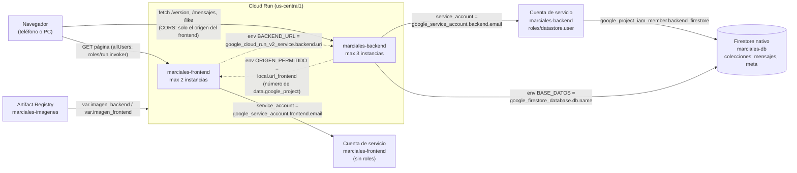

## Fase 0. Preparación

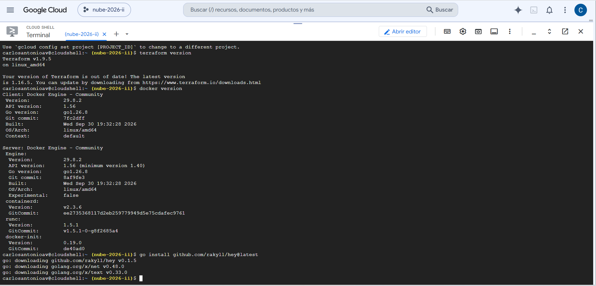

```bash
terraform version        # Terraform v1.9.5
docker version           # Docker Engine - Community 29.8.2
go install github.com/rakyll/hey@latest    # hey v0.1.5
```

## Fase 1. Las imágenes

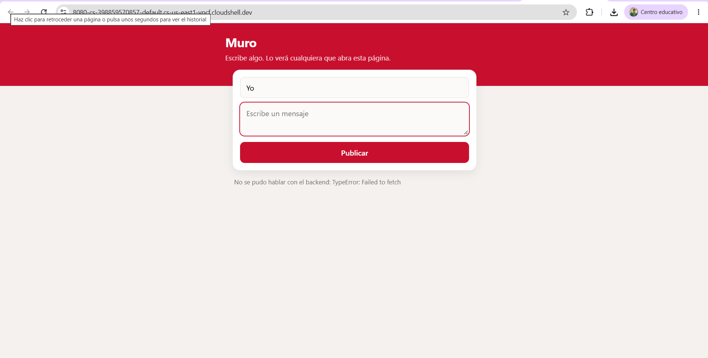

La página carga en la vista previa de Cloud Shell, pero dice `No se pudo hablar con el backend: TypeError: Failed to fetch`, porque todavía no hay backend.

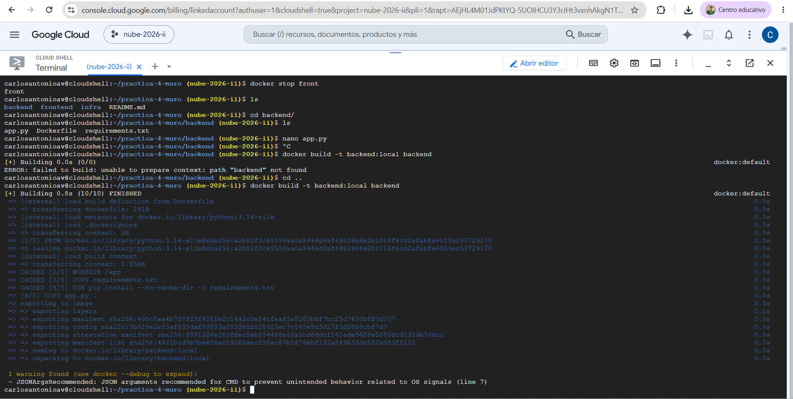

Después de cambiar el comentario de `app.py`, la segunda construcción reutiliza las capas de dependencias y solo rehace la copia del código:

```text
 => CACHED [2/5] WORKDIR /app
 => CACHED [3/5] COPY requirements.txt .
 => CACHED [4/5] RUN pip install --no-cache-dir -r requirements.txt
 => [5/5] COPY app.py .
```

```bash
docker build -t backend:local backend
docker build -t frontend:local frontend
docker run -d --rm --name front -p 8080:8080 frontend:local
docker stop front
docker build -t backend:local backend
```

## Fase 2. Los cimientos

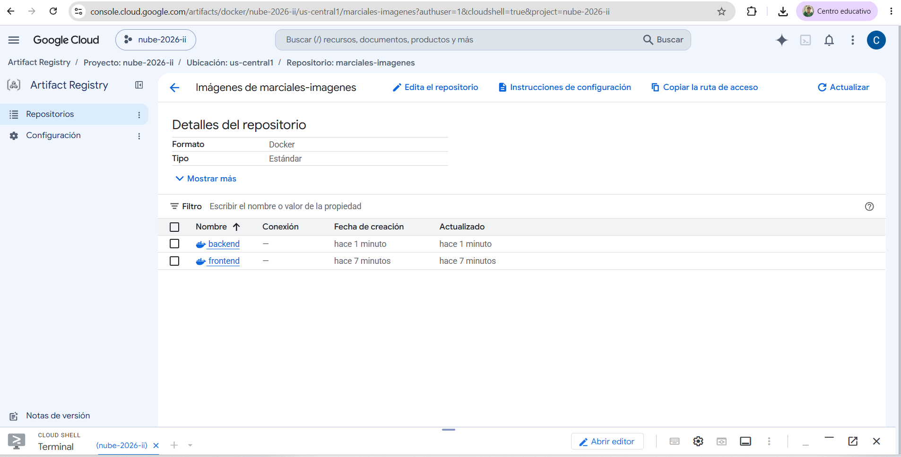

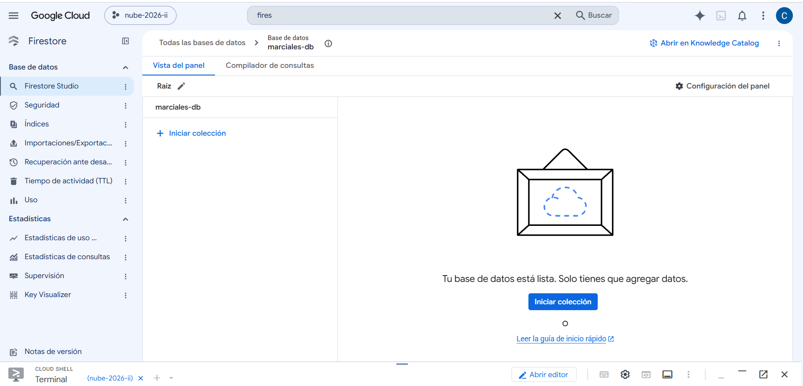

```bash
cd infra
terraform init
terraform apply
cd ..
RUTA=$(terraform -chdir=infra output -raw ruta_registro)
gcloud auth configure-docker us-central1-docker.pkg.dev --quiet
docker build -t $RUTA/backend:v1 backend
docker build -t $RUTA/frontend:v1 frontend
docker push $RUTA/backend:v1
docker push $RUTA/frontend:v1
```

## Fase 3. El backend

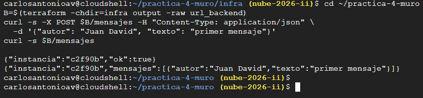

```bash
B=$(terraform -chdir=infra output -raw url_backend)
curl -s -X POST $B/mensajes -H "Content-Type: application/json" \
  -d '{"autor": "Juan David", "texto": "primer mensaje"}'
curl -s $B/mensajes
```

```text
{"instancia":"c2f90b","ok":true}
{"instancia":"c2f90b","mensajes":[{"autor":"Juan David","texto":"primer mensaje"}]}
```

## Fase 4. El frontend, conectado

El frontend recibe la URL del backend por referencia (`BACKEND_URL = google_cloud_run_v2_service.backend.uri`), y esa misma referencia le indica a Terraform que el backend se crea primero. El frontend tiene su propia cuenta de servicio, sin ningún rol.

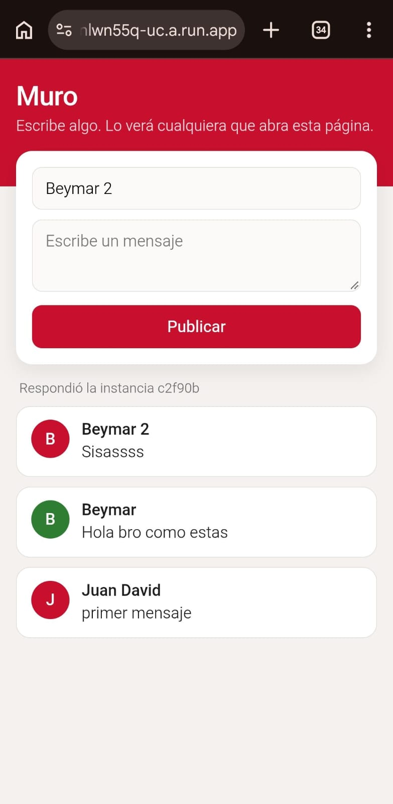

En el teléfono se ven el mensaje propio ("Juan David: primer mensaje") y dos mensajes escritos por otra persona desde su dispositivo ("Beymar" y "Beymar 2").

## Fase 5. El estado vive afuera

Con `max_instance_request_concurrency = 5` en el backend:

```bash
~/gopath/bin/hey -z 30s -c 15 $B/mensajes
# en otra pestaña
B=$(terraform -chdir=infra output -raw url_backend)
for i in $(seq 15); do curl -s $B/mensajes | cut -c1-30; done
```

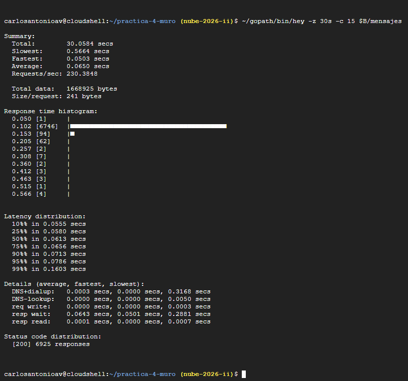

```text
Summary:
  Total:        30.0584 secs
  Slowest:      0.5664 secs
  Fastest:      0.0503 secs
  Average:      0.0650 secs
  Requests/sec: 230.3848

Latency distribution:
  50%% in 0.0613 secs
  90%% in 0.0713 secs
  99%% in 0.1603 secs

Status code distribution:
  [200] 6925 responses
```

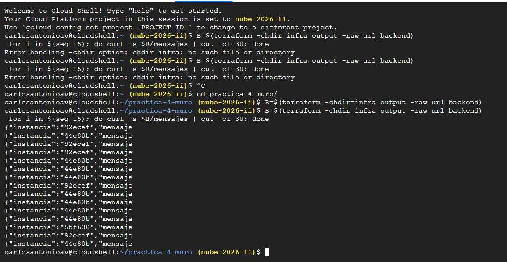

```text
{"instancia":"92ecef","mensaje
{"instancia":"44e80b","mensaje
{"instancia":"92ecef","mensaje
{"instancia":"92ecef","mensaje
{"instancia":"44e80b","mensaje
{"instancia":"44e80b","mensaje
{"instancia":"44e80b","mensaje
{"instancia":"92ecef","mensaje
{"instancia":"44e80b","mensaje
{"instancia":"44e80b","mensaje
{"instancia":"44e80b","mensaje
{"instancia":"44e80b","mensaje
{"instancia":"5bf630","mensaje
{"instancia":"92ecef","mensaje
{"instancia":"44e80b","mensaje
```

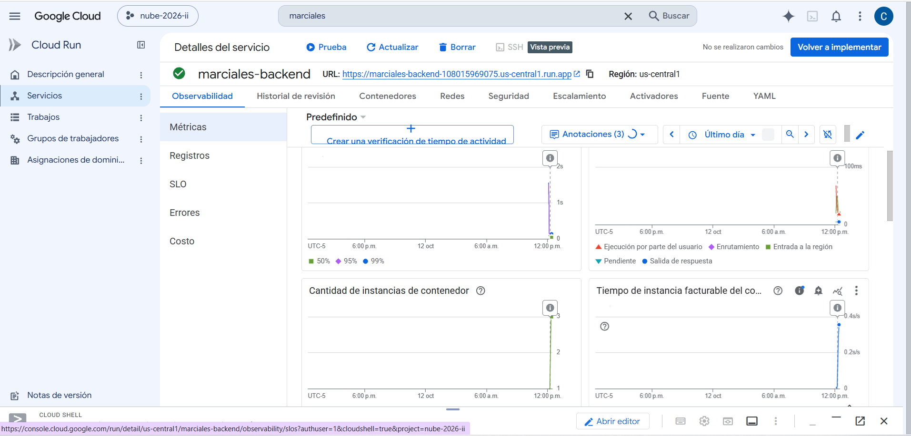

Las 6925 peticiones respondieron 200, con un promedio de 0,065 s. Durante la carga respondieron tres instancias distintas (`92ecef`, `44e80b` y `5bf630`), y la gráfica de Cloud Run muestra que el backend subió a 3 instancias, su máximo. Todas devuelven los mismos mensajes porque ninguna guarda estado: todas leen de Firestore. Al terminar se quitó la línea de concurrencia y se volvió a aplicar.

## Fase 6. Reto

Publicado como `v2` cambiando solo las etiquetas en `terraform.tfvars` (`backend:v2`, `frontend:v2`).

```bash
RUTA=$(terraform -chdir=infra output -raw ruta_registro)
docker build -t $RUTA/backend:v2 backend
docker push $RUTA/backend:v2
gcloud builds submit frontend --tag $RUTA/frontend:v2
terraform -chdir=infra apply
terraform -chdir=infra apply \
  -replace=google_cloud_run_v2_service.frontend \
  -replace=google_cloud_run_v2_service_iam_member.frontend_publico
```

El primer `apply` falló con `Image '.../frontend:v2' not found`, porque el `docker push` del frontend se cayó con `connect: connection refused`. Por eso el frontend se construyó y se subió con Cloud Build (`gcloud builds submit`), y sus permisos quedaron declarados en `main.tf` (`google_project_iam_member.build`). Como Terraform ya había registrado la imagen `v2` en el servicio, el segundo `apply` no veía cambios: el frontend se recreó con `-replace`.

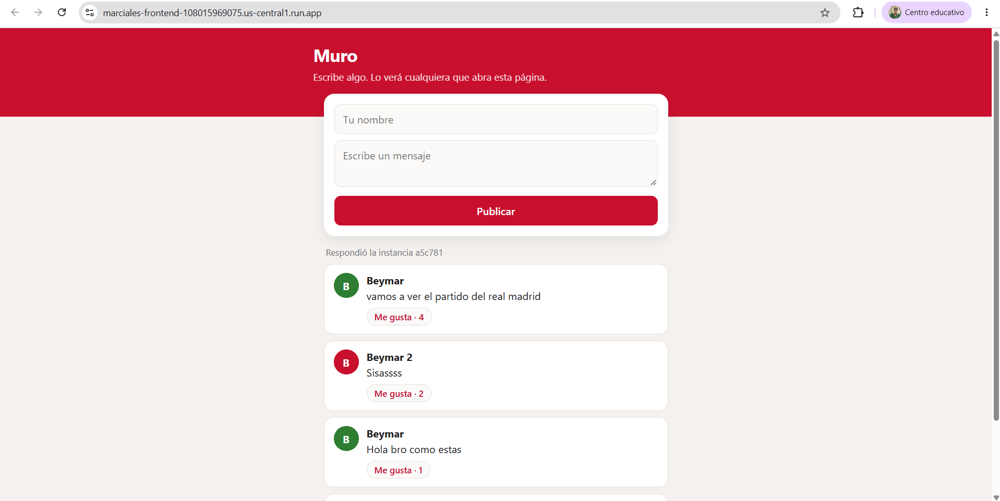

El muro, abierto desde `url_frontend` (`marciales-frontend-108015969075.us-central1.run.app`), muestra el botón "Me gusta" con su contador en cada mensaje (4, 2 y 1).

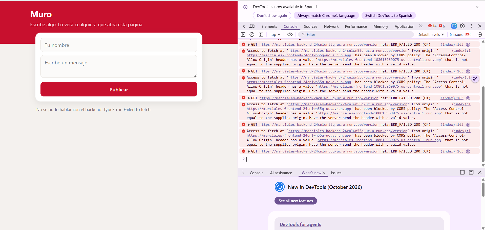

La misma página abierta desde `url_frontend_alterna` (`marciales-frontend-24cnlwn55q-uc.a.run.app`) no puede hablar con el backend. La consola del navegador muestra el bloqueo:

```text
Access to fetch at 'https://marciales-backend-24cnlwn55q-uc.a.run.app/version' from origin
'https://marciales-frontend-24cnlwn55q-uc.a.run.app' has been blocked by CORS policy: The
'Access-Control-Allow-Origin' header has a value
'https://marciales-frontend-108015969075.us-central1.run.app' that is not equal to the supplied origin.
```

La petición a `/version` sí llega y responde `200 (OK)`, pero el navegador descarta la respuesta porque el origen no coincide con el permitido.

### Decisiones

**1. La funcionalidad nueva: reacciones "Me gusta".**

- **Página:** cada mensaje tiene un botón "Me gusta · N" que llama a la API.
- **API:** `GET /mensajes` ahora devuelve también el `id` y los `likes` de cada mensaje, y hay un endpoint nuevo, `POST /mensajes/<id>/like`.
- **Firestore:** cada documento de `mensajes` tiene un campo entero `likes` que empieza en 0. La API lo aumenta con `firestore.Increment(1)`, una operación atómica del lado de la base: si dos personas reaccionan al mismo tiempo, se suman las dos reacciones sin que una pise a la otra. Los mensajes viejos, creados sin el campo, se muestran con 0.

**2. Cómo se rompe el ciclo de CORS.**

El frontend necesita la URL del backend, y el backend necesita la del frontend para ponerla en `Access-Control-Allow-Origin` (la variable `ORIGEN_PERMITIDO`, que `app.py` ya leía). Si el backend referenciara `google_cloud_run_v2_service.frontend.uri`, Terraform encontraría un ciclo. La solución aprovecha que Cloud Run le da a cada servicio una URL determinista, `https://<servicio>-<número de proyecto>.<región>.run.app`, como se ve en la Evidencia 5.2 (`marciales-backend-108015969075.us-central1.run.app`). Todas sus partes se conocen antes de crear el frontend: el prefijo, la región y el número de proyecto, que se lee con `data "google_project"`. Con eso se arma `local.url_frontend` y se le pasa al backend sin tocar el recurso frontend. La dependencia sigue yendo en un solo sentido (backend → frontend).

Qué la haría fallar:

- Abrir la página desde la otra URL del mismo servicio (`url_frontend_alterna`, con el formato `...-uc.a.run.app`). El navegador manda otro `Origin` y bloquea la respuesta, como se ve en la Evidencia 6.1.
- Un dominio personalizado, un cambio de nombre del servicio o un cambio de Google en el formato de sus URLs.

CORS no es autenticación: lo aplica el navegador, así que `curl` o un script siguen pudiendo llamar a la API.

**3. Cómo se bajaron las lecturas.**

Antes, la página pedía `/mensajes` cada 5 segundos, y cada petición cuesta hasta 20 lecturas en Firestore (una por mensaje devuelto). Ahora hay un documento `meta/estado` con un contador `version`, que la API incrementa en cada mensaje nuevo o reacción. La página consulta `GET /version` cada 5 segundos, que cuesta 1 lectura, y solo pide la lista completa cuando la versión cambió. Con la pestaña oculta no consulta nada, y al volver revisa de inmediato (evento `visibilitychange`).

Las lecturas no se midieron en la consola: la tabla es el cálculo a partir del código.

| Por pestaña abierta, 1 hora (cálculo) | Antes | Después |
|---|---|---|
| Muro sin cambios | 720 × 20 = 14 400 lecturas | 720 × 1 + 20 = 740 lecturas |
| Con 10 cambios en la hora | 14 400 lecturas | 720 + 10 × 20 = 920 lecturas |
| Pestaña oculta | 14 400 lecturas | 0 lecturas |

Lo que pierde el usuario: con la pestaña en segundo plano el muro no se actualiza hasta volver a ella, y cada mensaje o reacción cuesta una escritura extra en `meta/estado`.

**4. Cómo se resuelve la reproducción.**

El orden necesario es APIs → registro → imágenes → base, identidades y servicios. Terraform no puede hacerlo en un solo `apply`, porque las imágenes no son infraestructura: las produce Docker en medio. El script `desplegar.sh` lo hace en tres pasos:

1. `terraform apply -target=google_artifact_registry_repository.imagenes`: crea solo el registro y, por su `depends_on`, las APIs.
2. `docker build` y `docker push` de las dos imágenes, con la etiqueta que diga `terraform.tfvars` y con reintentos del push.
3. `terraform apply` completo: la base, las cuentas de servicio, el rol y los dos servicios, que ya encuentran sus imágenes.

### Preguntas

**¿Por qué con curl la API funciona aunque falten las cabeceras de CORS, y desde la página no?**
CORS es una regla del navegador, no del servidor. Cuando una página cargada desde el origen del frontend hace `fetch` a otro origen (el backend), el navegador revisa la cabecera `Access-Control-Allow-Origin` antes de entregarle la respuesta al JavaScript. Si no está o no coincide con el origen de la página, la descarta y deja el error en la consola. `curl` no es un navegador: no tiene un origen que proteger ni aplica esa política, solo hace la petición HTTP y muestra lo que llega.

**Si le quitas el rol a la cuenta de servicio del backend, ¿qué deja de funcionar, y dónde encontrarías el error?**
Sin `roles/datastore.user`, la cuenta `marciales-backend` ya no puede leer ni escribir documentos, así que fallan todas las rutas que tocan Firestore: listar, publicar, reaccionar y `/version`. El backend responde 500 y la página muestra que no pudo hablar con el backend. La ruta `/` sigue respondiendo `ok`, porque no usa la base. El error exacto aparece en los registros del servicio `marciales-backend` (Cloud Run > Registros): un error de permisos (`PermissionDenied`) que nombra el permiso faltante.

**¿Cuánto cuesta tu muro un mes sin visitas, y cuánto si cien personas lo dejan abierto todo el día, antes y después de tu cambio del reto?**
Sin visitas cuesta prácticamente 0: Cloud Run escala a cero y no cobra si no hay peticiones, y Firestore solo guarda unos pocos KB. Con cien pestañas abiertas 24 horas, antes del cambio son 100 × 14 400 × 24 ≈ 34,6 millones de lecturas al día, cuando la cuota gratis de Firestore es de 50 000 lecturas diarias (y solo para la primera base del proyecto). Después del cambio son 100 × 720 × 24 ≈ 1,7 millones de lecturas al día más las recargas por cambios: unas 20 veces menos. Las peticiones a Cloud Run no bajan, porque la página sigue consultando cada 5 segundos: 100 × 720 × 24 ≈ 1,7 millones al día, por encima de los 2 millones gratis al mes.
