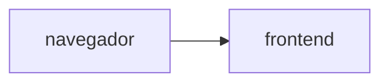

# Muro de mensajes

**Equipo:**
**Proyecto de Google Cloud:**
**URL del muro:**

## Diagrama

## Fase 0. Preparación

## Fase 1. Las imágenes

## Fase 2. Los cimientos

## Fase 3. El backend

## Fase 4. El frontend, conectado

## Fase 5. El estado vive afuera

Se añadió `max_instance_request_concurrency = 5` al backend y se generó carga para forzar varias instancias; mientras tanto, el muro se pidió desde otra pestaña. Los mensajes se ven igual desde cualquier instancia porque se guardan en Firestore y no en la memoria del contenedor. Terminado el experimento, se quitó el límite y se volvió a aplicar.

## Fase 6. Reto

### Decisiones

### Preguntas
